# Exploração dos dados

Figuras para entender os dados antes das análises principais. Elas não precisam entrar no relatório. O plano do trabalho está em [planejamento.md](planejamento.md).

Para gerar tudo de novo:

```bash
.venv/bin/python scripts/01_upas_capitais.py      # conta os pronto-atendimentos por capital
.venv/bin/python scripts/02_setores_capitais.py   # monta a tabela de setores (população, renda, favela)
.venv/bin/python scripts/04_exploracao.py         # figuras 01 a 08
cd scripts && ../.venv/bin/python 05_esquema_dijkstra.py && cd ..   # figura 09
.venv/bin/python scripts/03_distancias_capital.py "Fortaleza - CE"            # Dijkstra, todos os PAs
.venv/bin/python scripts/03_distancias_capital.py "Fortaleza - CE" --so-sus   # Dijkstra, só SUS
cd scripts && ../.venv/bin/python 06_figuras_rede.py "Fortaleza - CE"          # figuras 10 a 12
```

As bibliotecas estão em `.venv/` (lista em [requirements.txt](requirements.txt)).

---

## 1. Os dados em uma tabela

| Fonte | Unidade | Quantidade | Variáveis que usamos |
|---|---|---|---|
| CNES (24/10/2026) | pronto-atendimento | 274 nas 27 capitais | localização, se atende o SUS, se funciona 24h |
| IBGE, Censo 2022 | capital | 27 | população |
| IBGE, Censo 2022 | setor censitário | 92.494 habitados | população, área, densidade, renda média do responsável, favela |
| OpenStreetMap | rua | uma rede por capital | comprimento, mão única |

Um **setor censitário** é a menor área em que o IBGE divulga dados. Nas capitais, um setor habitado tem em média **503 moradores** (mediana 483), o que em área urbana densa corresponde a poucos quarteirões.

---

## 2. Quantos pronto-atendimentos cada capital tem

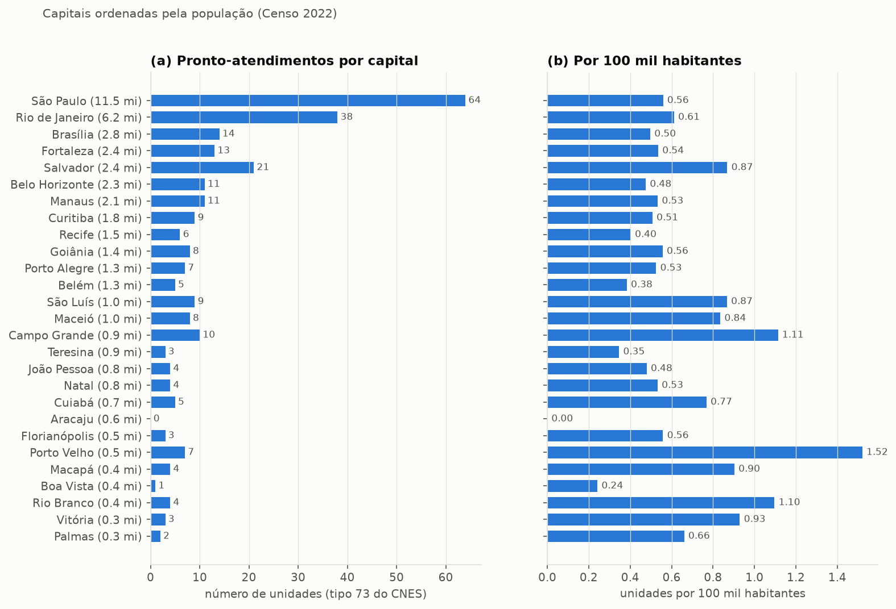

- **(a)** O número absoluto acompanha a população: São Paulo (64) e Rio (38) lideram.
- **(b)** Por habitante, a variação é grande. A média das capitais é **0,59 unidade por 100 mil habitantes**. Porto Velho tem 1,52 e Boa Vista tem 0,24; Aracaju aparece com zero porque suas duas unidades de urgência estão cadastradas como hospitais.
- Não há um padrão simples de "capital pequena tem mais por habitante": Teresina e Boa Vista estão entre as menores taxas, e Porto Velho e Rio Branco entre as maiores.

## 3. Prévia da lei de escala (L1)

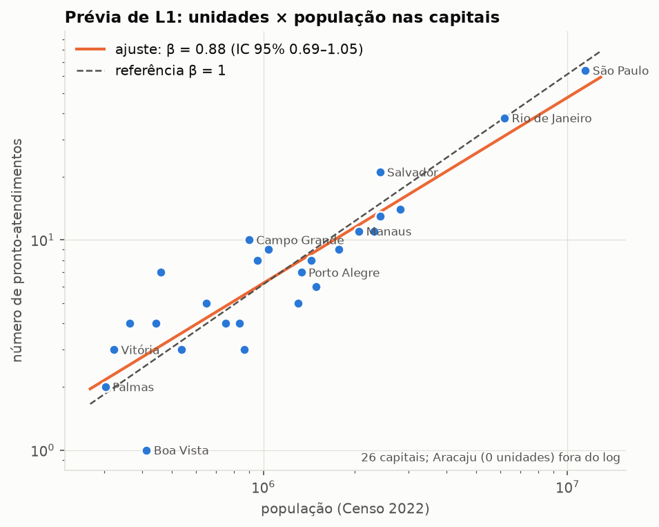

- Cada ponto é uma capital, em escala log nos dois eixos. Numa lei de potência $N = A\,P^\beta$, o log transforma a curva em reta, e a inclinação é β.
- **β = 0,88, com intervalo de confiança de 95% (bootstrap) de 0,69 a 1,05.** O valor pontual sugere um crescimento um pouco sublinear: capitais maiores teriam um pouco menos unidades por habitante.
- **O intervalo inclui 1**, então com 26 capitais **não dá para rejeitar a proporcionalidade**. Esse é o resultado honesto da L1 e deve ser escrito assim.
- A dispersão em torno da reta é grande para as capitais pequenas (Boa Vista com 1, Porto Velho com 7), o que é esperado quando as contagens são pequenas.

## 4. Renda

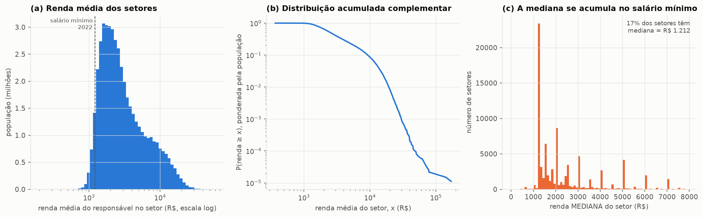

- **(a)** Distribuição da renda média do responsável por setor, ponderada pela população, em escala log. Nas 27 capitais, metade dos setores tem renda média acima de **R$ 2.672**; 10% ficam abaixo de R$ 1.374 e 10% acima de R$ 10.129. A distribuição é assimétrica, com cauda longa à direita.
- **(b)** Distribuição acumulada complementar $P(\text{renda} \ge x)$ em log-log, a mesma ferramenta de Newman que usaremos na L3. A curva **não é uma reta**: ela cai cada vez mais rápido. Logo, a renda média dos setores não segue uma lei de potência na faixa observada.
- **(c)** Por que usamos a renda **média** e não a mediana: 17% dos setores têm mediana exatamente igual a R$ 1.212, o salário mínimo de 2022. Muitos responsáveis ganham exatamente um salário mínimo, e a mediana "trava" nesse valor, sem separar os setores.

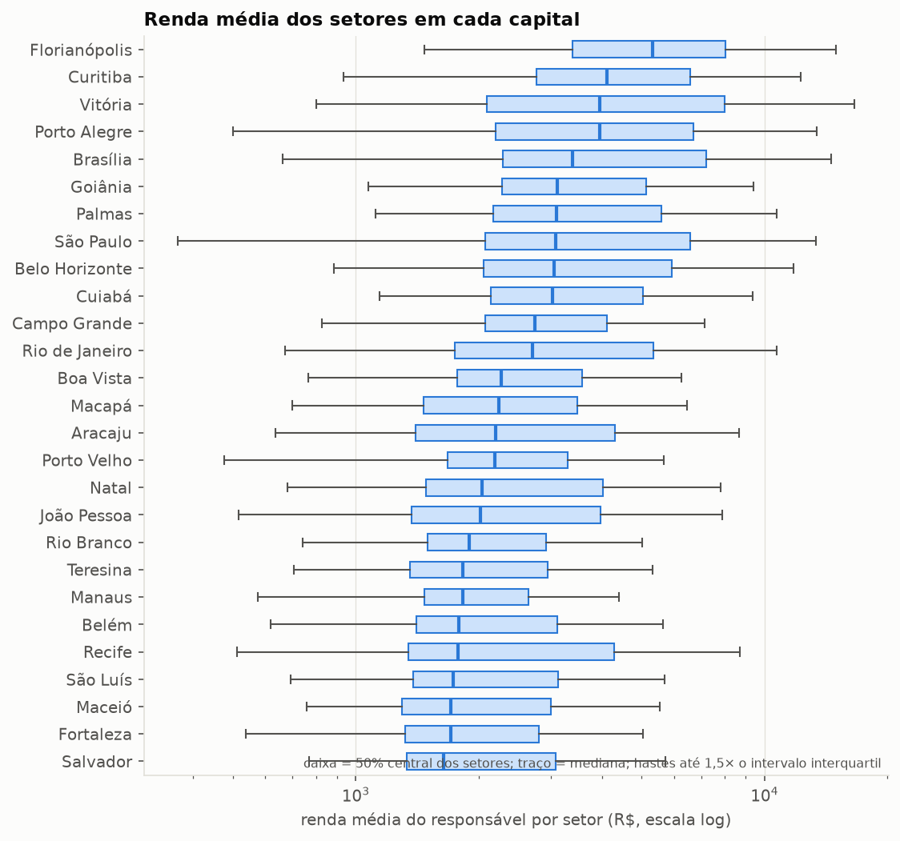

- Cada caixa mostra a faixa central (50%) da renda dos setores de uma capital. As capitais do Sul, do Sudeste, Brasília e Florianópolis estão no topo; as do Norte e do Nordeste, embaixo.
- Por isso, na tabela densidade × renda do planejamento (seção 6.1), os quartis de renda são calculados **dentro de cada capital**. Um setor "pobre" em Florianópolis pode ter renda maior que um setor "médio" em Teresina.

## 5. Densidade

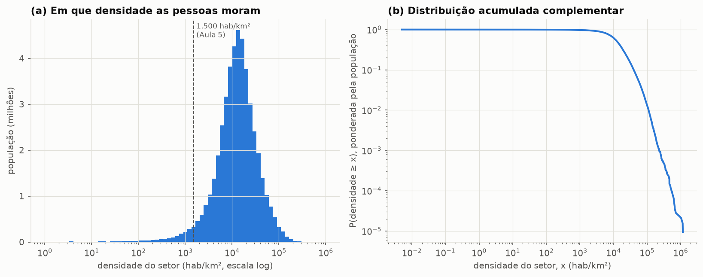

- **(a)** Em que densidade as pessoas moram. O pico fica perto de **10 mil hab/km²**. Só 3,7% da população das capitais mora em setores abaixo do limiar de 1.500 hab/km² da Aula 5.
- **(b)** A cauda vai até cerca de 1 milhão de hab/km². São setores muito pequenos, com prédios altos ou conjuntos habitacionais, e o valor é real: um quarteirão de 0,01 km² com 10 mil moradores tem essa densidade.
- Consequência: o corte "acima/abaixo de 1.500" separa pouca gente. Para a tabela densidade × renda, os **quartis de densidade** dentro de cada capital funcionam melhor.

## 6. Densidade e renda andam juntas?

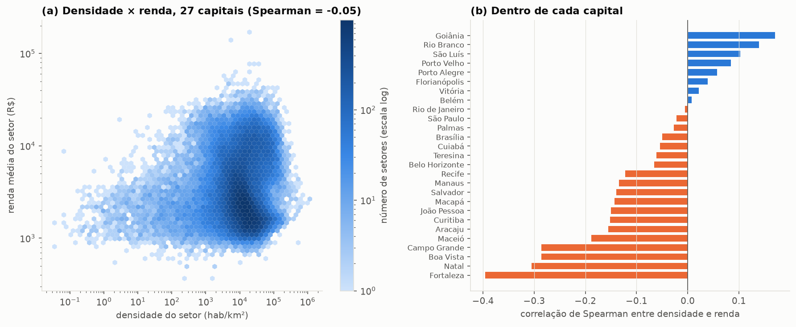

- **(a)** Juntando as 27 capitais, quase não há correlação (Spearman = −0,05).
- **(b)** Dentro de cada capital, o quadro muda. **Em Fortaleza, setores mais densos são mais pobres** (−0,40), e o mesmo vale, com menos força, para Natal, Boa Vista e Campo Grande. Em Goiânia e Rio Branco acontece o contrário.
- **Por que isso importa:** na seção 6.2 do planejamento, separamos o efeito da densidade e o da renda sobre a oferta de unidades. Onde as duas andam juntas, como em Fortaleza, olhar só a renda misturaria os dois efeitos. Por isso precisamos dos resíduos ou da regressão com as duas variáveis.
- A correlação de Spearman usa a ordem dos valores, e não os valores em si. Assim, ela não é distorcida pelos poucos setores com densidade extrema.

## 7. Favelas

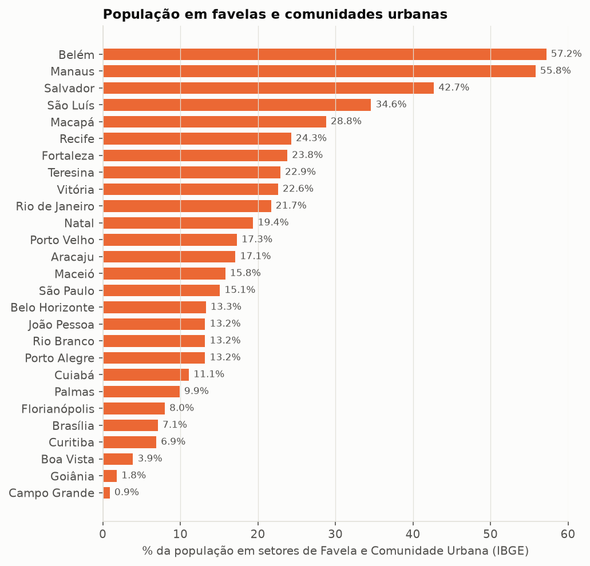

- Belém (57%) e Manaus (56%) têm mais da metade da população em setores de favela e comunidade urbana; Salvador tem 43%. Em Campo Grande e Goiânia, são menos de 2%.
- A favela é um indicador direto de necessidade social, com base na Aula 2 (slide 17).

## 8. Fortaleza no mapa

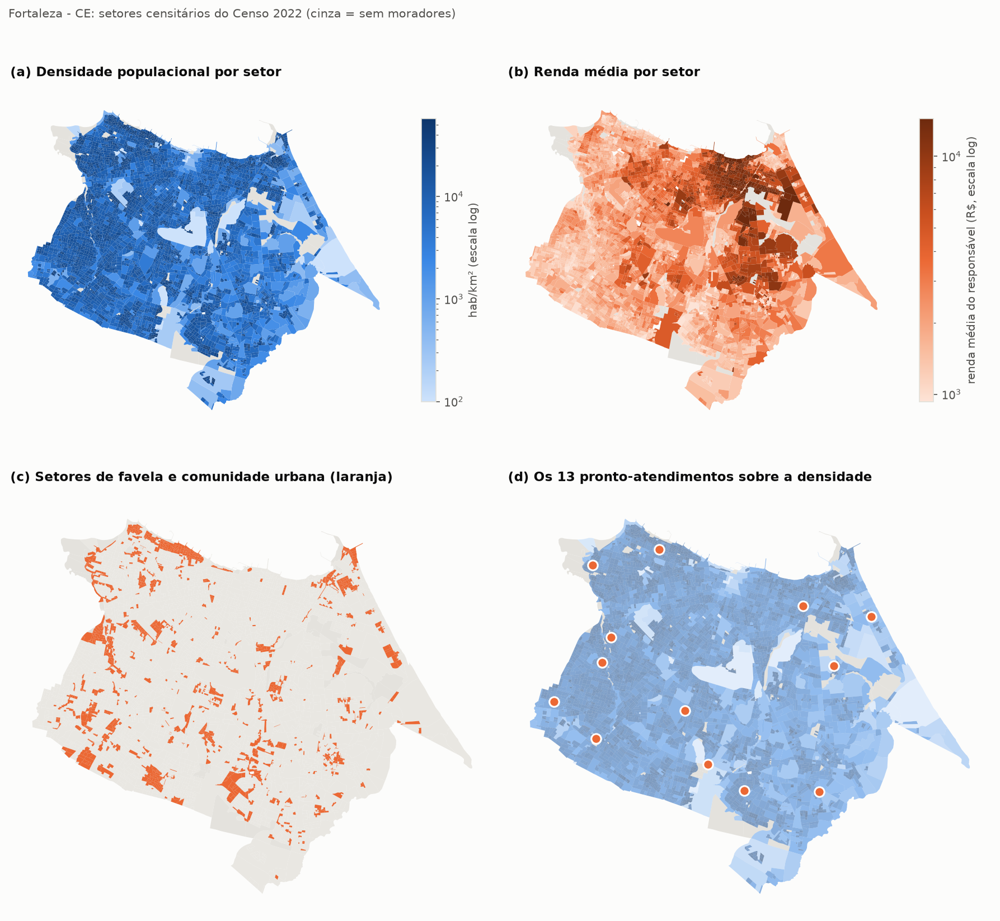

- **(a) Densidade:** o oeste e o sul são densos e homogêneos. As manchas claras são áreas verdes, lagoas e grandes equipamentos.
- **(b) Renda:** a renda alta se concentra no centro-norte e no leste. Os bairros com maior renda média (ponderada pela população, entre bairros com mais de 5 mil moradores) são Guararapes (R$ 14.966), Cocó, Meireles e Aldeota. O oeste e o sul são mais pobres.
- **(c) Favelas:** espalhadas pela cidade, com concentração no oeste, no litoral norte e no sul.
- **(d) Os 13 pronto-atendimentos:** 12 deles atendem o SUS e ficam fora dos bairros mais ricos, sobretudo na periferia oeste e sul, que é densa e mais pobre. O único na área de renda mais alta é o **Pronto Atendimento Aldeota**, que **não atende o SUS** e não funciona 24h.
- **Primeira impressão:** em Fortaleza, a rede do SUS parece **favorecer os mais pobres**, o que seria uma oferta compensatória (δ < 0 na seção 6.2 do planejamento). A seção 10 confirma isso com as distâncias pela rua.
- Uma explicação possível, a ser discutida com cuidado: quem tem renda alta usa mais o pronto-atendimento privado. Por isso a comparação "todos os PAs" × "só SUS" importa (seção 10).

---

## 9. O que o Dijkstra faz

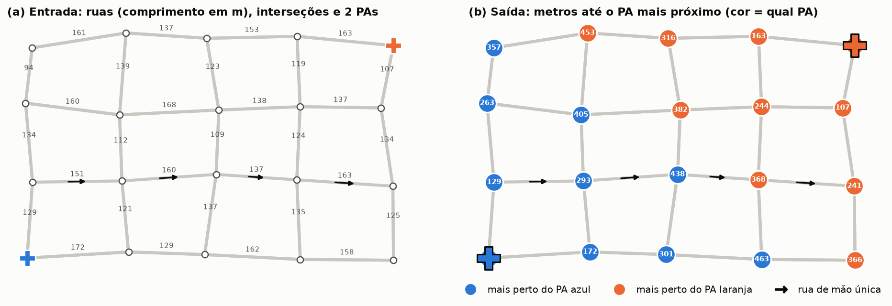

**A ideia.** A rede viária vira um **grafo**: cada interseção é um **nó** e cada trecho de rua entre duas interseções é uma **aresta**, com peso igual ao seu comprimento em metros. Uma rua de mão única é uma aresta com um só sentido. O **algoritmo de Dijkstra** encontra o caminho mais curto pelas arestas, sem atravessar quarteirões, de um ponto de partida até todos os outros nós.

**Como ele funciona, passo a passo:**

1. Dá distância 0 ao ponto de partida e "infinito" a todos os outros nós.
2. Pega o nó ainda não finalizado com a **menor** distância conhecida e o marca como finalizado. Na primeira vez, é o próprio ponto de partida.
3. Para cada vizinho desse nó, testa se chegar por ele é mais curto do que a distância já conhecida. Se for, atualiza.
4. Repete os passos 2 e 3 até finalizar todos os nós.

Como ele sempre finaliza primeiro o nó mais próximo, quando um nó é finalizado sua distância já é a menor possível. Ela não pode melhorar depois, porque qualquer outro caminho passaria por nós ainda mais distantes.

**Três adaptações que usamos:**

- **Multi-fonte:** em vez de um ponto de partida, começamos com **todos os pronto-atendimentos ao mesmo tempo**, todos com distância 0. É como se cada unidade soltasse uma onda que se espalha pelas ruas; cada nó é alcançado primeiro pela onda da unidade mais próxima. Numa única execução, obtemos (i) a distância de cada nó até a unidade mais próxima e (ii) **qual** é essa unidade. Na figura, isso é o número dentro do círculo e a cor.
- **Grafo invertido:** queremos a distância **da casa até a unidade**, mas o Dijkstra parte das unidades. Por isso invertemos o sentido de todas as arestas antes. Assim, uma rua de mão única que só vai da casa para a unidade é usada no sentido certo. Na figura (b), o nó com **368** fica laranja porque a avenida de mão única impede o caminho mais direto até o PA azul.
- **Ligação dos setores à rede:** cada setor é representado por um ponto dentro dele e ligado à interseção mais próxima. A distância final é a ligação do setor + o caminho pela rede + a ligação da unidade.

**O que isso nos dá para o trabalho:**

- A **distância de cada setor** até a unidade mais próxima: é a variável da L3 e da tabela densidade × renda.
- As **áreas de atendimento**: os setores da mesma cor formam a área de uma unidade. A área e a população delas entram na L2 ($D \propto \rho^\alpha$).

---

## 10. A rede viária de Fortaleza e o resultado do Dijkstra

*Números com as coordenadas já corrigidas (seção 11).*

A rede foi recortada do extrato do OpenStreetMap para o Nordeste (Geofabrik, 25/10/2026), porque o servidor Overpass estava sobrecarregado. O filtro de vias é o mesmo que o `osmnx` usa para `network_type="drive"`.

### A rede

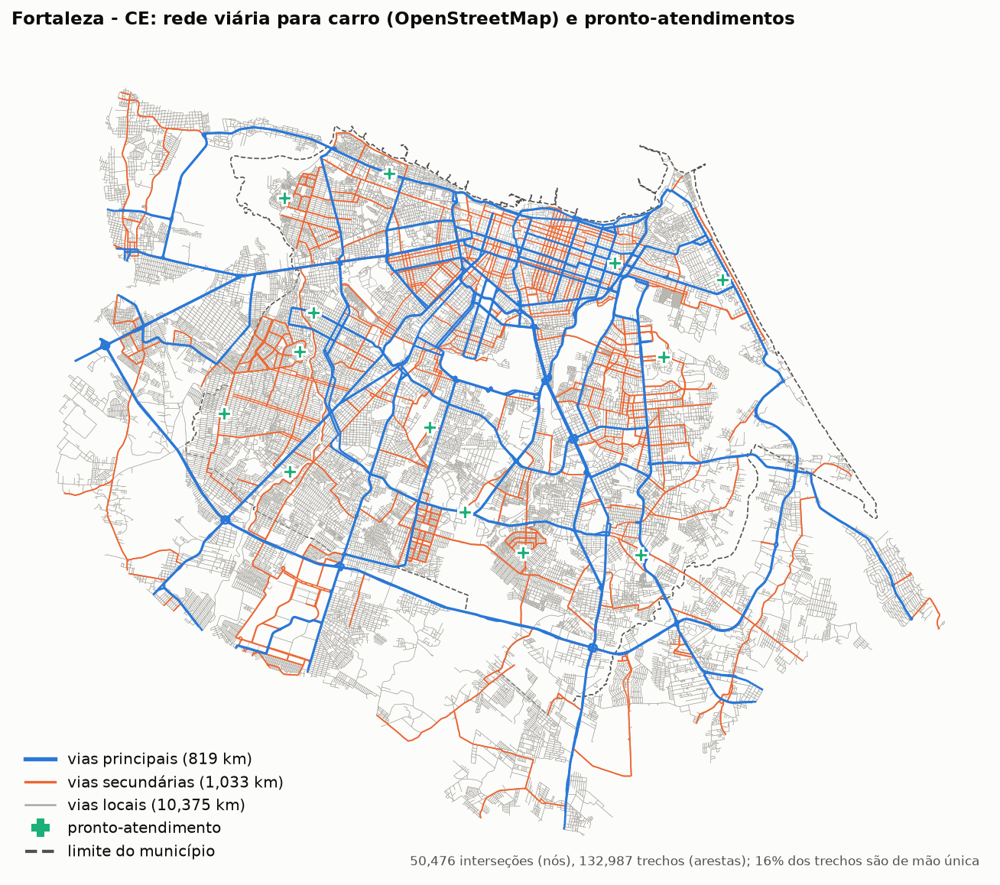

- **50.476 interseções (nós) e 132.987 trechos (arestas)**, considerando o município mais a faixa de 5 km em volta. Ficou só a maior parte da rede em que todo nó alcança todo nó.
- São 819 km de vias principais, 1.033 km de secundárias e 10.375 km de vias locais. **16% dos trechos são de mão única**, e por isso o grafo é dirigido e invertido antes do Dijkstra.
- A rede continua além do limite municipal (Caucaia, Maracanaú, Eusébio), para que rotas que passam pelos vizinhos não sejam cortadas.

### A "onda" do Dijkstra

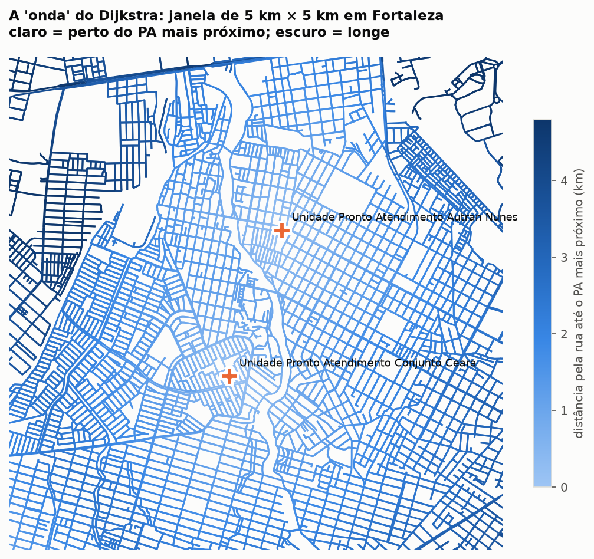

- Cada trecho de rua tem a cor da distância até o pronto-atendimento mais próximo. A cor clareia perto de cada unidade e escurece à medida que se afasta, seguindo as ruas e não a linha reta.
- Onde duas "ondas" se encontram fica a fronteira entre duas áreas de atendimento.

### As distâncias

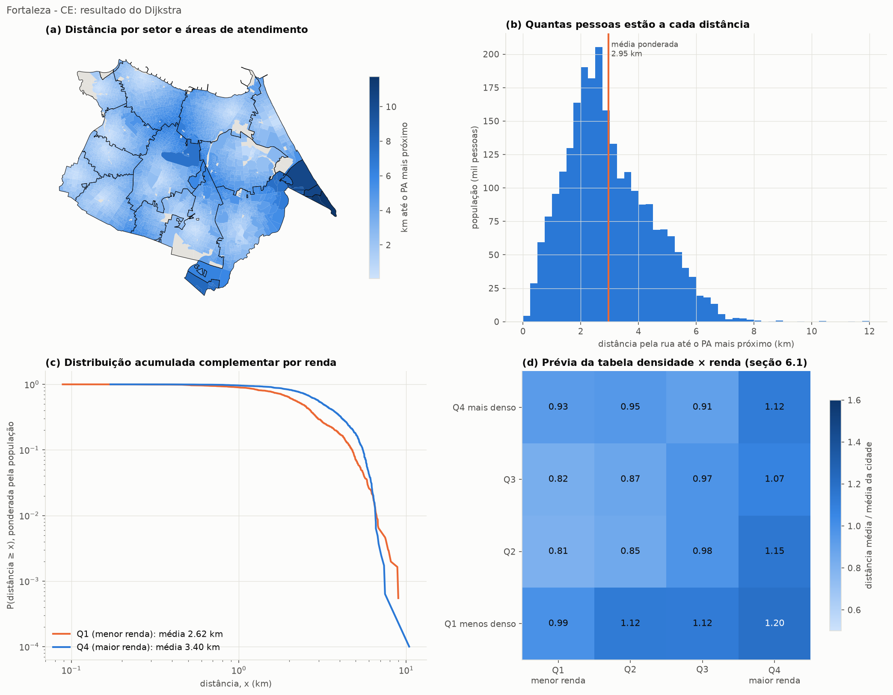

**Conferências (todas passaram):** nenhum setor ficou sem caminho até uma unidade. Nenhum setor tem distância pela rua menor que a linha reta. Só 1 setor habitado tem ligação à rede acima de 500 m. A distância pela rua é, em mediana, **1,36 vez** a distância em linha reta.

- **(a)** Distância por setor e as 13 áreas de atendimento (contornos). O ponto mais distante é a faixa litorânea do extremo leste (Sabiaguaba), a quase 12 km.
- **(b)** Distribuição das pessoas pela distância. A média ponderada é **2,95 km** e a mediana **2,71 km**. Quase todo mundo está a menos de 7 km, e a distribuição termina de forma abrupta, sem cauda longa.
- **(c)** Distribuição acumulada complementar em log-log, para os quartis de menor e maior renda. **As curvas não são retas:** elas despencam perto de 6–7 km. Em Fortaleza, **a distância até a unidade não segue lei de potência**. É uma distribuição com corte, e faz sentido, porque a cidade tem tamanho finito e as unidades estão espalhadas. Esse é um resultado da L3 e deve ser escrito assim (planejamento, seção 7: "é um teste, não uma premissa").
- **(d)** Prévia da tabela densidade × renda. Cada célula é a distância média dos setores daquela combinação dividida pela média da cidade (1,00 = média):
  - **Leitura vertical:** os setores menos densos (linha de baixo) ficam mais longe (0,99 a 1,20).
  - **Leitura horizontal:** em todas as faixas de densidade, o quartil de **menor renda fica mais perto** (0,81 a 0,99) e o de **maior renda mais longe** (1,07 a 1,20).
  - **Conclusão preliminar para Fortaleza:** a localização favorece os mais pobres e os mais densos.

### Todos os PAs × só SUS

| Grupo | Todos os 13 PAs | Só os 12 do SUS |
|---|---|---|
| Distância média ponderada | 2,95 km | 3,25 km |
| Quartil de menor renda (Q1) | 2,62 km | 2,66 km |
| Quartil de maior renda (Q4) | 3,40 km | **4,34 km** |
| Setores de favela | 2,74 km | 2,84 km |
| Setores fora de favela | 3,02 km | 3,38 km |

Sem o PA privado da Aldeota, a distância dos mais ricos aumenta quase 1 km, e a dos mais pobres quase não muda. A rede do SUS é claramente orientada para os bairros de menor renda.

### Problema encontrado: coordenadas erradas no CNES

Comparando o bairro do endereço cadastrado com o bairro onde a coordenada cai:

| Unidade | Bairro no endereço | Onde a coordenada cai | Situação |
|---|---|---|---|
| UPA Conjunto Ceará | Conjunto Ceará | Vila Velha, a 5,5 km do bairro Conjunto Ceará I | coordenada com só 4 casas decimais; provável erro |
| UPA Canindezinho | Planalto Vitória (CEP igual ao da UPA Messejana) | São Bento, a 13,2 km do bairro Canindezinho | provável erro |
| Outras 11 | — | o mesmo bairro ou um vizinho | ok |

Duas unidades em 13 com localização duvidosa mudam as áreas de atendimento. **Antes da análise final, precisamos conferir as 274 unidades:**
1. Comparar automaticamente o bairro do endereço com o bairro do IBGE onde a coordenada cai.
2. Corrigir à mão os casos que não batem, usando o endereço.

---

## 11. Conferência das coordenadas das 274 unidades

Script: [scripts/07_conferir_coordenadas.py](scripts/07_conferir_coordenadas.py). Resultado completo, com um link de mapa para a coordenada original e para a final: `dados/processados/conferencia_coordenadas.csv`. As coordenadas usadas daqui em diante estão em `dados/processados/pa_capitais_corrigido.csv`.

### Como a conferência funciona

1. **Onde a unidade deveria estar:** no bairro do endereço do CNES ou no bairro que aparece no nome da unidade (por exemplo, "UPA **Cristo Redentor**"). Os bairros vêm da malha do IBGE. Onde a malha não tem bairros, usamos os distritos (São Paulo) ou os subdistritos (Brasília, Goiânia).
2. **Onde a coordenada cai:** em qual bairro do IBGE, e a que distância do bairro esperado.
3. **Sinais de erro:**
   - a coordenada fica a mais de 1,5 km do bairro esperado;
   - a coordenada está fora do município;
   - várias unidades de bairros diferentes estão a menos de 100 m umas das outras. Isso é sinal de coordenada genérica: em Salvador, 5 unidades de bairros diferentes estavam no mesmo ponto do Rio Vermelho.
4. **Correção:** busca do endereço, do CEP e do nome da unidade no Nominatim (o buscador de endereços do OpenStreetMap). O resultado só é aceito se cair no município e perto do bairro esperado. Se a busca cair perto da coordenada original, a original é **confirmada**.
5. **Último recurso, só para erros grosseiros** (mais de 5 km, fora do município ou coordenada compartilhada): um ponto dentro do bairro esperado, marcado como **aproximado**.
6. **Correções manuais:** o que for colocado em `dados/correcoes_manuais.csv` (colunas `CO_CNES,lat,lon,nota`) tem a palavra final.

### Resultado

| Situação da coordenada final | Unidades |
|---|---|
| Original, dentro ou perto (até 1,5 km) do bairro esperado | 187 |
| Original confirmada pela busca do endereço | 26 |
| Corrigida pela busca do endereço ou do nome | 19 |
| Aproximada por um ponto dentro do bairro esperado | 22 |
| Original mantida, sem como confirmar (**revisar**) | 20 |
| **Total** | **274** |

- **41 unidades (15%) foram movidas.** Algumas estavam muito longe: a UPA Jardim Novo Mundo (Goiânia) estava a 48 km, fora do município. A UPA Jabaquara (São Paulo) estava a 30 km. A UPA Vera Cruz (São Paulo) estava no marco zero da cidade, na Praça da Sé.
- **Coordenadas genéricas** (unidades de bairros diferentes no mesmo ponto) apareceram em Salvador (5 unidades), São Luís (5) e Maceió (2). Em outras capitais, unidades caíam exatamente no "Centro" (Rio, Belo Horizonte, Boa Vista, Macapá). Em São Paulo, duas unidades de bairros diferentes estavam a cerca de 130 m uma da outra, na Água Rasa: a Clinisul foi corrigida pela busca do endereço, e a AMA Jardim Nordeste ficou para revisão.
- **As 20 unidades para revisar** mantiveram a coordenada original. Quase todas estão em capitais sem bairros na malha do IBGE (Porto Velho, Rio Branco, Palmas, Goiânia, São Paulo), onde a busca do endereço não deu resultado. Várias parecem corretas, como a AMA Jardim Peri Peri, que cai no Butantã. A mais suspeita é a **AMA 24h Jardim Nordeste**, em São Paulo, que cai na Água Rasa.
- **Em Fortaleza:** a UPA Conjunto Ceará foi corrigida pela rua do endereço. A UPA Canindezinho foi aproximada pelo bairro Canindezinho, onde fica o nome dela. A UPA Cristo Redentor e a UPA Bom Jardim foram **mantidas**, porque o nome da unidade e a busca do endereço confirmam a coordenada original.

### Por que isso importa

Uma unidade no lugar errado muda as áreas de atendimento e as distâncias de todos os setores em volta. Nas capitais com poucas unidades, um único erro de 10 km pode mudar a conclusão sobre renda. Essa conferência deve aparecer no texto final, em uma frase na metodologia e outra nas limitações.

---

## 12. As 26 capitais

Script: [scripts/09_resumo_capitais.py](scripts/09_resumo_capitais.py) (depois de [scripts/08_todas_capitais.sh](scripts/08_todas_capitais.sh), que roda o Dijkstra em todas). Tabela completa: `dados/processados/resumo_distancias_capitais.csv`. Aracaju fica de fora porque não tem unidade do tipo 73.

**Conferências:** nas 52 execuções (26 capitais × "todos os PAs" e "só SUS"), nenhum setor ficou sem caminho e nenhuma distância pela rua saiu menor que a linha reta.

**Setores sem acesso viário mapeado:** setores cuja rua mais próxima fica a mais de 2 km foram **excluídos**. São ilhas (Belém, Salvador, Manaus) e áreas rurais ribeirinhas de municípios enormes (Porto Velho chega a 116 km). Neles, a "distância" seria uma linha reta sobre água ou mata. A população excluída é pequena na maioria das capitais e maior em:

| Capital | População excluída |
|---|---|
| Porto Velho | 4,4% |
| Belém | 3,9% |
| Macapá | 2,7% |
| Boa Vista | 2,2% |
| Rio Branco | 1,5% |
| demais | menos de 1% |

### Quem mora mais longe, os mais pobres ou os mais ricos?

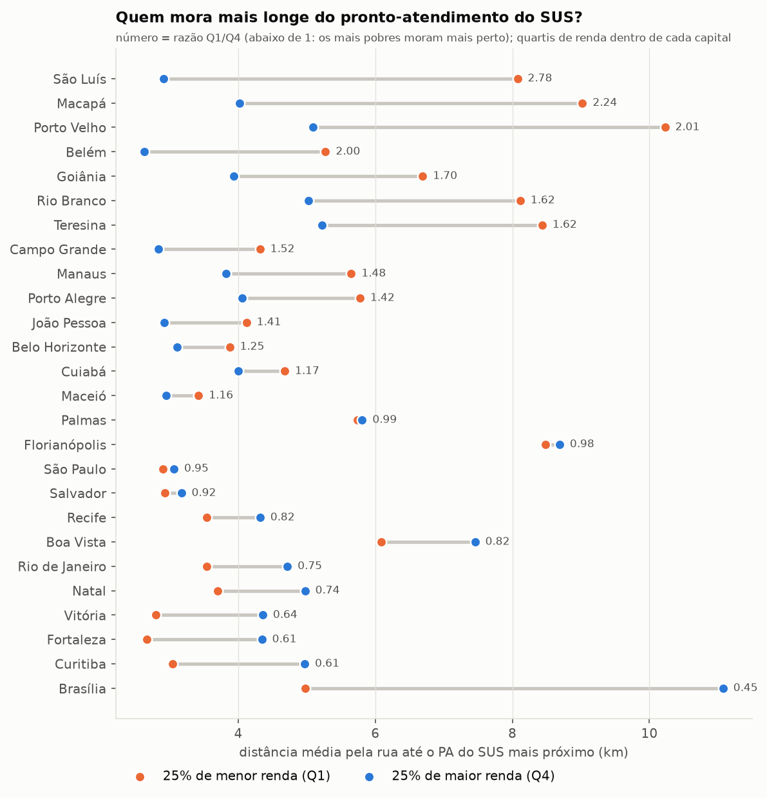

- Cada linha liga a distância média dos **25% de menor renda** (laranja) e dos **25% de maior renda** (azul) de uma capital, até o pronto-atendimento **do SUS** mais próximo. Os quartis são calculados dentro de cada capital.
- **Não há um padrão único no Brasil.** Em **12 das 26** capitais, os mais pobres moram mais perto; em 14, mais longe.
- **A favor dos mais pobres:** Brasília (razão 0,45), Curitiba e Fortaleza (0,61), Vitória (0,64), Natal, Rio e Recife. Em Brasília, o quartil de maior renda (que mora sobretudo no Plano Piloto, com 26% dessa população, e em Águas Claras, com 18%) fica a 11 km do PA do SUS mais próximo.
- **Contra os mais pobres:** São Luís (2,78), Macapá (2,24), Porto Velho (2,01), Belém (2,00), Goiânia (1,70). Nessas capitais, os mais pobres moram duas a quase três vezes mais longe.
- **Favela:** em **18 das 26** capitais, quem mora em setor de favela fica mais perto do PA do SUS do que quem mora fora.

### Densidade e renda juntas: a resposta à pergunta central

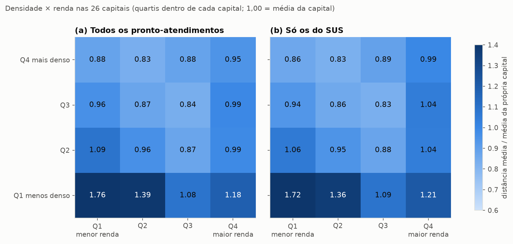

Cada célula é a distância média daquele grupo de setores dividida pela média da própria capital (1,00 = média), juntando as 26 capitais.

- **Nas áreas densas (duas linhas de cima), a localização é boa para todos e até um pouco melhor para os mais pobres:** valores de 0,83 a 0,94 nas três primeiras colunas.
- **Nas áreas pouco densas (linha de baixo), a renda pesa muito:** os mais pobres ficam **72% mais longe** que a média da cidade (1,72), contra 1,21 dos mais ricos.
- **Conclusão preliminar:** a pobreza sozinha não explica a distância. O grupo mal servido é o dos **pobres que moram em áreas pouco densas**, tipicamente a periferia em expansão. Uma hipótese a discutir no texto, sem dados nossos para testá-la: os mais ricos que moram longe (1,21) têm mais acesso a carro e a plano de saúde que os mais pobres na mesma situação.
- Os dois painéis quase não diferem. Nas capitais juntas, as unidades fora do SUS são poucas (29 de 274) para mudar o padrão, embora mudem bastante em algumas capitais, como Fortaleza.

### O que falta para responder à pergunta com as leis de potência

- **L2 e resíduos (planejamento, seção 6.2):** ajustar $D \propto \rho^\alpha$ nas áreas de atendimento e testar se as áreas mais pobres ficam abaixo da reta. Isso transforma a tabela acima num teste com intervalo de confiança.
- **L3 nas 26 capitais:** verificar se a ausência de lei de potência na distribuição da distância, vista em Fortaleza, se repete.
- **L1 final:** a prévia (β = 0,88; IC 0,69–1,05) não muda com a correção das coordenadas, porque usa só a contagem de unidades.
